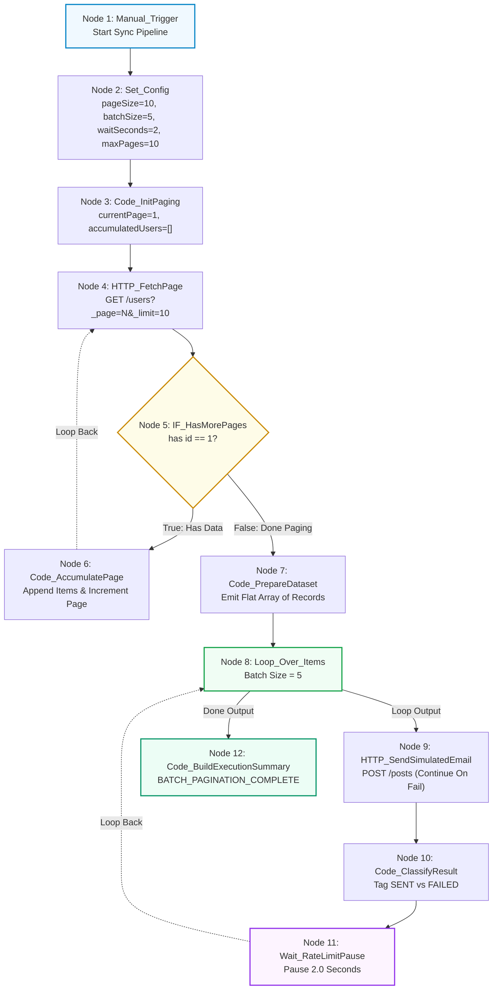

# Requirement Document: N8N Hands-On Intermediate Course
## Topic 5: Loop Processing, Pagination & Rate-Limited Batching

---

## 1. Document Control

| Field | Value |
| :--- | :--- |
| **Document Title** | Topic 5: Loop Processing, Pagination & Rate-Limited Batching - Requirement File |
| **Course** | N8N - Hands On Intermediate Course (Level 2) |
| **Target Audience** | Automation Engineers, Integration Architects, Operations Analysts |
| **Version** | 1.0 |
| **Status** | Approved & Completed |
| **Last Updated** | October 16, 2026 |
| **Prepared By** | Lead Automation Architect |

---

## 2. Learning Concepts & Objectives

### 2.1 Course Objective
Build an enterprise-grade paginated fetch and rate-limited batch processing workflow in n8n. The workflow loops through a paginated mock user API until all records are retrieved, consolidates the pages, splits the dataset into batches of 5, sends simulated emails with item-level error isolation, pauses for 2 seconds between batches, and aggregates final delivery statistics.

### 2.2 Learning Scope
* **Pagination Loop Design:** Fetching records iteratively using `HTTP Request` (`GET /users?_page=N&_limit=10`), evaluating page termination conditions with an `IF` node (`IF_HasMorePages`), and accumulating records in global memory (`Code_AccumulatePage`).
* **Always Output Data Handling:** Ensuring that when an API returns an empty array (`[]`, 0 items) on the terminal page, downstream conditional nodes receive an execution trigger instead of aborting the execution branch.
* **Dataset Consolidation & Flattening:** Unrolling accumulated in-memory arrays into independent n8n items (`Code_PrepareDataset`).
* **Rate-Limited Batch Partitioning:** Utilizing the `Loop Over Items` (Split in Batches) node to process exactly 5 items per iteration.
* **Fault-Isolated API Dispatch:** Configuring `HTTP Request` (`POST /posts`) with `Continue Regular Output` (`onError: continueRegularOutput`) to ensure individual item failures do not crash the running batch.
* **Item-Level Status Classification:** Inspecting individual dispatch responses and assigning structured tags (`SENT` vs `FAILED`).
* **Enforced Inter-Batch Delay:** Implementing a 2-second rate-limiting pause using the `Wait` node before returning control to the batch loop.
* **Pipeline Audit Aggregation:** Emitting an end-to-end execution summary from the `done` output handle detailing total harvested pages, processed records, and completion timestamps.

---

## 3. Workflow Architecture

---

## 4. Node Configuration Specifications

| Node ID | Node Name | Node Type | Critical Parameters & Configuration |
| :--- | :--- | :--- | :--- |
| **N5-01** | `Manual_Trigger` | `n8n-nodes-base.manualTrigger` | Manual trigger for sync testing on demand. |
| **N5-02** | `Set_Config` | `n8n-nodes-base.set` (v3.4) | `pageSize: 10`, `batchSize: 5`, `waitSeconds: 2`, `maxPages: 10`. |
| **N5-03** | `Code_InitPaging` | `n8n-nodes-base.code` (v2) | Initializes `$getWorkflowStaticData('global').accumulatedUsers = []` and `currentPage = 1`. |
| **N5-04** | `HTTP_FetchPage` | `n8n-nodes-base.httpRequest` (v4.2) | `GET https://jsonplaceholder.typicode.com/users`, `_page = {{ $('Code_AccumulatePage').isExecuted ? $('Code_AccumulatePage').last().json.currentPage : 1 }}`, `_limit = {{ $('Set_Config').first().json.pageSize || 10 }}`, **Always Output Data: true**. |
| **N5-05** | `IF_HasMorePages` | `n8n-nodes-base.if` (v2) | Left: `{{ $json.id ? 1 : 0 }}`, Operator: `equals`, Right: `1`. Routes valid data to `true`, empty responses to `false`. |
| **N5-06** | `Code_AccumulatePage` | `n8n-nodes-base.code` (v2) | Concatenates incoming page records into `staticData.accumulatedUsers`, increments `currentPage += 1`, loops back to `HTTP_FetchPage`. |
| **N5-07** | `Code_PrepareDataset` | `n8n-nodes-base.code` (v2) | Unrolls `staticData.accumulatedUsers` array into independent n8n items (`return users.map(user => ({ json: user }))`). |
| **N5-08** | `Loop_Over_Items` | `n8n-nodes-base.splitInBatches` (v3) | `batchSize: 5`. `loop` output routes to batch pipeline, `done` output routes to summary. |
| **N5-09** | `HTTP_SendSimulatedEmail` | `n8n-nodes-base.httpRequest` (v4.2) | `POST https://jsonplaceholder.typicode.com/posts`, `jsonBody: ={{ JSON.stringify({ to: $json.email, name: $json.name, subject: "Enterprise Operations Update" }) }}`, `onError: continueRegularOutput`. |
| **N5-10** | `Code_ClassifyResult` | `n8n-nodes-base.code` (v2) | Mode: `runOnceForEachItem`. Classifies response into `status: "SENT"` or `"FAILED"`, records `processedAt`. |
| **N5-11** | `Wait_RateLimitPause` | `n8n-nodes-base.wait` (v1.1) | Resume: `After time interval`, Amount: `2.00` seconds. Output loops back to `Loop_Over_Items`. |
| **N5-12** | `Code_BuildExecutionSummary` | `n8n-nodes-base.code` (v2) | Emits final audit: `pipelineSummary: "BATCH_PAGINATION_COMPLETE"`, `totalUsersProcessed: 10`, `totalPagesHarvested: 1`. |

---

## 5. Verification & Testing Checkpoints

### 5.1 Pagination Loop Test
* **Pass 1 (Page 1):** `HTTP_FetchPage` fetches 10 user records (`id: 1` through `id: 10`). `IF_HasMorePages` evaluates `true` (id is present). `Code_AccumulatePage` stores 10 records and sets `currentPage = 2`.
* **Pass 2 (Page 2):** `HTTP_FetchPage` requests `_page=2`. Remote API returns `[]`. Because **Always Output Data** is enabled, an empty item is emitted. `IF_HasMorePages` evaluates `false` (no id present), safely terminating the pagination loop.
* **Dataset Check:** `Code_PrepareDataset` emits a consolidated list of exactly 10 individual items.

### 5.2 Rate-Limited Batch Processing Test
* **Batch 1:** `Loop_Over_Items` emits records 1 to 5 to `HTTP_SendSimulatedEmail`. `Code_ClassifyResult` marks them as `SENT`. `Wait_RateLimitPause` halts execution for 2.0 seconds.
* **Batch 2:** `Loop_Over_Items` emits records 6 to 10 to `HTTP_SendSimulatedEmail`. `Code_ClassifyResult` marks them as `SENT`. `Wait_RateLimitPause` halts execution for 2.0 seconds.
* **Completion:** `Loop_Over_Items` completes all iterations and triggers the `done` output. `Code_BuildExecutionSummary` emits the audit payload.
* **Total Execution Duration:** Exactly ~10.6 seconds demonstrating rate-limit enforcement without worker starvation.

---

## 6. Production Edge Cases & Mitigation Strategies

| Risk Scenario | Impact | Mitigation Implemented |
| :--- | :--- | :--- |
| **Infinite Pagination Loop** | Remote API ignores pagination parameters or never returns empty data. | Configured `maxPages: 10` guard condition in accumulator script. |
| **Empty Page Halting** | When API returns `[]`, default n8n behavior drops execution branch. | Enabled `alwaysOutputData: true` on `HTTP_FetchPage` to guarantee terminal trigger. |
| **Expression Evaluation Ambiguity** | Wait node receives string `= 2 ` instead of numeric value `2`. | Enforced fixed numeric input `2.00` seconds on `Wait_RateLimitPause`. |
| **Single Item Failure Crashing Batch** | Malformed email address causes HTTP 400 error aborting remaining records. | Enabled `onError: continueRegularOutput` on `HTTP_SendSimulatedEmail` and tagged errors in `Code_ClassifyResult`. |
